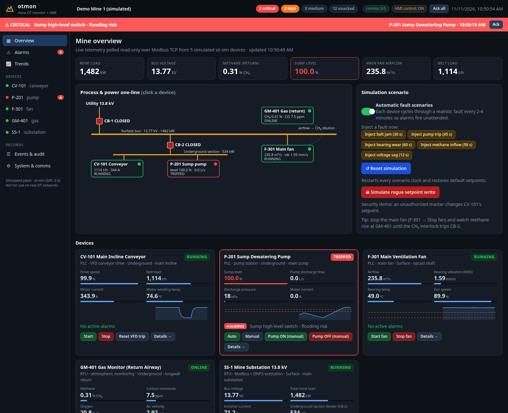
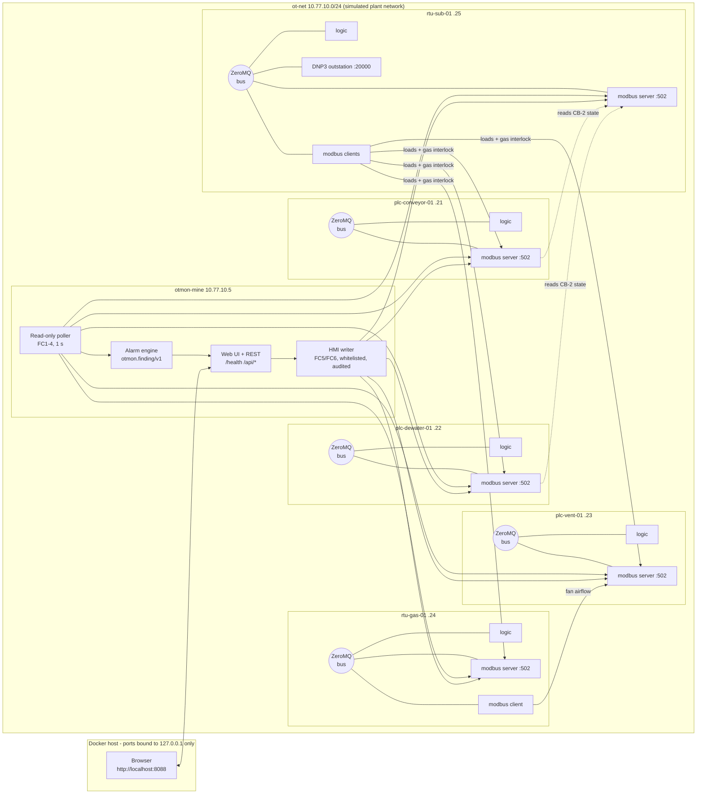

# Mine OT simulation + otmon-mine monitor

A self-contained, one-command demo of an **underground mine's OT network**: five simulated
PLCs/RTUs built on [patsec/ot-sim](https://github.com/patsec/ot-sim) speaking **Modbus TCP**
(and **DNP3** at the substation), watched by **otmon-mine**, a browser dashboard + operator HMI
built from the concepts of the OTMon air-gapped OT monitor.



> **Using an AI coding assistant to set this up?** Point it at [AGENTS.md](AGENTS.md): exact,
> non-interactive steps for prerequisites, bring-up, health checks, stopping and troubleshooting.

## Quick start

Requirements: Docker Engine or Docker Desktop with **Compose v2** (`docker compose version`),
about 2 GB free disk, internet access for the first build (Debian packages, Go toolchain, the
pinned ot-sim source from GitHub). Works on Linux, macOS and Windows (Docker Desktop/WSL2),
x86-64. (ARM64/Apple Silicon: see Caveats.)

```bash
./run.sh            # build (first time ~5-10 min) + start + wait until healthy
# open http://localhost:8088
./run.sh verify     # optional: end-to-end self-test, exit 0 = all good
./run.sh stop       # stop everything
```

Without the script: `docker compose up -d --build`, then open <http://localhost:8088>.
Windows without bash: run the `docker compose` commands directly from PowerShell.

Once it is running **nobody needs the terminal**: everything (alarms, acknowledge, trends,
device details, start/stop, setpoints, fault injection, simulation reset) is in the browser.

## What is simulated

| Device (container) | Role | What it models | Faults that fire alarms |
|---|---|---|---|
| `plc-conveyor-01` CV-101 | PLC, VFD conveyor drive | Main incline belt: speed, belt speed, load t/h, motor current, winding temp, kW | Belt jam → overcurrent → **VFD trips** after 12 s; motor over-temperature |
| `plc-dewater-01` P-201 | PLC, pump station | Sump level with inflow, auto start/stop on level, discharge flow/pressure | **Pump trip** → sump rises → level HI / HIHI → high-level switch (flooding risk) |
| `plc-vent-01` F-301 | PLC, main ventilation fan | Fan speed, airflow, fan pressure, bearing vibration and temp, kW | **Bearing wear** → vibration HI 4.5 / HIHI 7.1 mm/s; airflow LO if stopped |
| `rtu-gas-01` GM-401 | RTU, atmospheric monitoring | CH₄, CO, O₂, air velocity. **Reads F-301 airflow over Modbus** (ot-sim client) so methane dilution follows ventilation | **Methane inflow** → CH₄ ≥ 1.0 % alert, ≥ 1.5 % power-cut interlock |
| `rtu-sub-01` SS-1 | RTU, 13.8 kV substation, **Modbus + DNP3 outstation** | CB-1 incomer, CB-2 underground feeder, V, A, kW, PF, Hz. **Reads every load and the gas interlock from the other devices over Modbus** | **Voltage sag** → undervoltage; CH₄ interlock **opens CB-2**, which stops CV-101 and P-201 (they read CB-2 state back over Modbus) |

All physics and fault logic is in ot-sim's own **logic module** (expressions in
`devices/*.xml`); nothing is faked in the monitor. With *automatic fault scenarios* on (the
default) every device cycles through its fault every 2.5-4 minutes, so alarms fire on their own.
Cause and effect is real: stop the main fan from the HMI and methane at GM-401 climbs until the
interlock trips CB-2 at the substation, which de-energizes and stops the conveyor and the
sump pump (so the sump starts to fill).

### Register map (all devices: Modbus unit 1, port 502, raw 0-based addresses)

Engineering value = raw ÷ 10^scale. Full map with live values: each device page in the UI
("Register map & live values"), or `monitor/config/mine.yaml`.

| Device | Input registers (FC4) | Discrete inputs (FC2) | Coils (FC1/FC5) | Holding (FC3/FC6) |
|---|---|---|---|---|
| CV-101 | 0 speed % ÷10 · 1 belt m/s ÷100 · 2 load t/h · 3 current A ÷10 · 4 temp °C ÷10 · 5 kW | 0 running · 1 overcurrent · 2 VFD trip · 3 jam · 4 supply energized | 0 run · 1 inject jam · 2 auto faults · 3 trip reset · 4 sim reset | 0 speed SP % |
| P-201 | 0 level % ÷10 · 1 inflow L/s ÷10 · 2 outflow ÷10 · 3 pressure kPa · 4 current ÷10 · 5 kW | 0 running · 1 tripped · 2 high level · 3 supply energized | 0 auto · 1 manual run · 2 inject trip · 3 auto faults · 4 trip reset · 5 sim reset | 0 start level % · 1 stop level % |
| F-301 | 0 speed % ÷10 · 1 airflow m³/s ÷10 · 2 dp Pa · 3 vibration mm/s ÷100 · 4 bearing °C ÷10 · 5 kW | 0 running · 1 vib trip level | 0 run · 1 inject bearing wear · 2 auto faults · 3 reset · 4 sim reset | 0 speed SP % |
| GM-401 | 0 CH₄ % ÷100 · 1 CO ppm ÷10 · 2 O₂ % ÷10 · 3 air m/s ÷100 · 4 fan airflow seen ÷10 | 0 CH₄ ≥1.0 % · 1 CH₄ ≥1.5 % interlock | 0 inject methane · 1 auto faults · 2 sim reset | – |
| SS-1 | 0 kV ÷100 · 1 A ÷10 · 2 total kW · 3 PF ÷1000 · 4 Hz ÷100 · 5 section kW | 0 CB-1 closed · 1 CB-2 closed · 2 undervoltage · 3 gas interlock | 0 CB-1 close cmd · 1 CB-2 close cmd · 2 inject sag · 3 auto faults · 4 sim reset | – |

SS-1 DNP3 outstation (TCP 20000, outstation 1024, master 1): binary inputs 0-3 = the four
discrete inputs above, analog inputs 0-5 = the six input registers, binary outputs 0-1 = CB-1/CB-2
commands (CROB). Read it with the bundled tool:
`docker compose exec rtu-sub-01 mine-dnp3-poll 127.0.0.1`.

From the host, devices are also reachable for your own tools (e.g. `mbpoll`) on
`127.0.0.1:15021`…`15025` (Modbus) and `127.0.0.1:20000` (DNP3).

## The dashboard (otmon-mine)

* **Overview**: KPI strip, live one-line mimic (power and process, click to drill in), a card per
  device with status, bars, sparkline and quick controls, plus the **scenario panel**: automatic
  faults on/off, one-click fault injection per device, **Reset simulation**, and a **rogue-write
  attack demo**.
* **Alarms**: ISA-18.2-style list (active/unacked, active/acked, returned/unacked), per-alarm
  and *Ack all*, alarm history; flashing banner and header counters for unacknowledged alarms.
* **Trends**: pick any analog points; canvas charts with alarm-limit lines and hover read-out,
  2-15 minute windows.
* **Device pages**: controls (start/stop, auto/manual, breaker open/close), setpoint sliders,
  fault injection, device alarms, all trends, full register map with live values.
* **Events & audit**: every alarm transition and every operator write, in OTMon's
  `otmon.finding/v1` format (also appended to `findings.jsonl` in the `otmon-state` volume).
* **System**: per-device link status, poll latency, error counts.
* `GET /health` (200 when every device is polled OK, else 503), `GET /api/status`,
  `/api/history`, `/api/events`; `POST /api/write`, `/api/ack`, `/api/scenario`.
* All front-end assets are local (no CDN, no JS libraries): works fully offline.

### How it relates to OTMon

The monitor reuses OTMon's design rather than its packet sensor:

| OTMon concept | Here |
|---|---|
| Read-only poller, write function codes refused in code (`ReadOnlyMaster`) | Same class, used for all monitoring (FC1-4, 1 s floor) |
| Findings in `otmon.finding/v1`, deterministic rules, alert on **transitions** only | Same schema; `R-PROC-*`, `R-RNG-003`, `R-WR-001`, `R-POLL-ERR/OK` |
| `R-RNG-003`: polled value outside approved baseline | Setpoints have baselines in `mine.yaml`; the rogue-write demo trips it |
| `R-WR-001`: unexpected write | A watched setpoint/command that changes with no HMI write in the last 6 s |
| Local-only dashboard, Host-header check, stdlib only | Same (port published on 127.0.0.1 only) |

**Deliberate difference:** OTMon never writes to OT equipment. This demo was asked to include
operator controls, so writes go through a **separate** `HmiWriter` path (FC5/FC6) limited to
whitelisted points, range-checked and audit-logged. Run `OTMON_HMI_WRITES=0 ./run.sh` to get a
pure read-only OTMon-style monitor (buttons disabled, `/api/write` refused).

## Architecture



Each device container runs ot-sim's **CPU module**, which starts the ZeroMQ **message bus**
(the "backplane"), the **logic module** (physics + faults, 1 s scan) and the **Modbus**
module; SS-1 also runs the C++ **DNP3** module. HELICS co-simulation is not used: the logic
module is enough for this scenario and keeps the stack small.

## Repository layout

| Path | What |
|---|---|
| `run.sh` | One-command bring-up / verify / status / stop / clean |
| `docker-compose.yml` | 5 device containers + monitor on a fixed-subnet network |
| `devices/*.xml` | ot-sim device configs: logic program, Modbus/DNP3 maps, Modbus clients |
| `scripts/gen_device_configs.py` | Generator for `devices/*.xml` (edit + re-run to change the scenario) |
| `otsim/Dockerfile` | Builds ot-sim (pinned commit) CPU/logic/Modbus/bus/DNP3 + `mine-dnp3-poll` |
| `otsim/dnp3-poll/` | Read-only DNP3 class-0 poll tool (opendnp3), replaces pydnp3 |
| `monitor/` | otmon-mine: `otmon_mine/` (engine, server, verify, static UI), `config/mine.yaml` |
| `scripts/verify.sh` | Scripted end-to-end check (exit 0 = devices live, DNP3 ok, alarms fire) |
| `AGENTS.md` | Deterministic setup steps for AI assistants |

## Caveats and honest limits

* **Simulation only.** Values are plausible, not engineering-grade models. Do not connect any
  of this to a real OT network; the HMI can write.
* **pydnp3 / Debian Bookworm:** upstream's DNP3 *test master* (`pydnp3`) does not build on
  Bookworm and upstream's Docker image is Bookworm-based. The DNP3 **outstation** (C++,
  opendnp3) builds fine, so this repo keeps Bookworm and ships its own read-only C++ class-0
  poller (`mine-dnp3-poll`) instead of downgrading to Ubuntu 20.04. The monitor itself polls
  Modbus only; DNP3 is verified by `verify.sh`.
* **Not using the upstream image as-is:** upstream's Dockerfile also installs Node-RED,
  Tailscale and HELICS and builds every module. This build only compiles the modules used
  (smaller, fewer moving parts). ot-sim is pinned to commit `9dc3304` (2026-09-25).
* **ARM64 / Apple Silicon:** `otsim/Dockerfile` downloads the amd64 Go toolchain. On an ARM
  host either build with `DOCKER_DEFAULT_PLATFORM=linux/amd64` (emulated, slower) or change
  `linux-amd64` to `linux-arm64` in the Dockerfile. Only x86-64 was tested.
* **ot-sim is chatty:** every device logs each tag update; container logs are capped at 2×5 MB.
* On `docker compose stop` ot-sim's Go modules sometimes print a ZeroMQ nil-pointer panic
  while shutting down. It is an upstream shutdown race and harmless.
* The monitor keeps trend history in memory (15 min); restarting it clears trends.
* No authentication on the dashboard: it is bound to `127.0.0.1`. If you expose it (reverse
  proxy, tunnel), add auth and/or set `OTMON_HMI_WRITES=0`, and add the public host name to
  `OTMON_ALLOWED_HOSTS`.

## Licence

GPL-3.0, matching upstream ot-sim. See [LICENSE](LICENSE) and [THIRD-PARTY.md](THIRD-PARTY.md)
(including what GPL means if you distribute the built Docker image).
